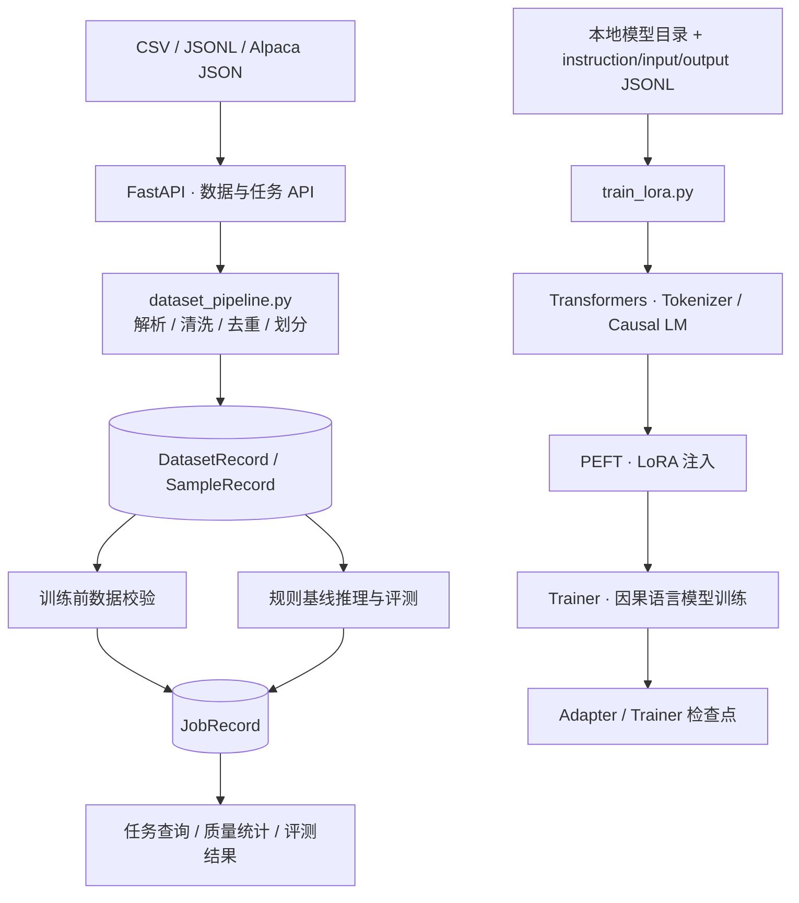
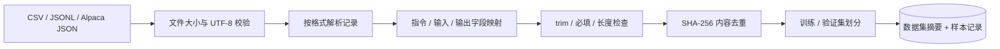
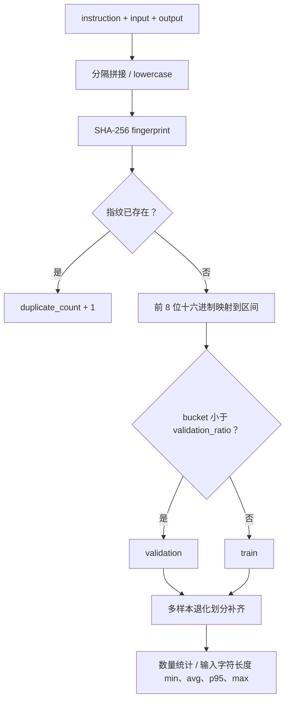
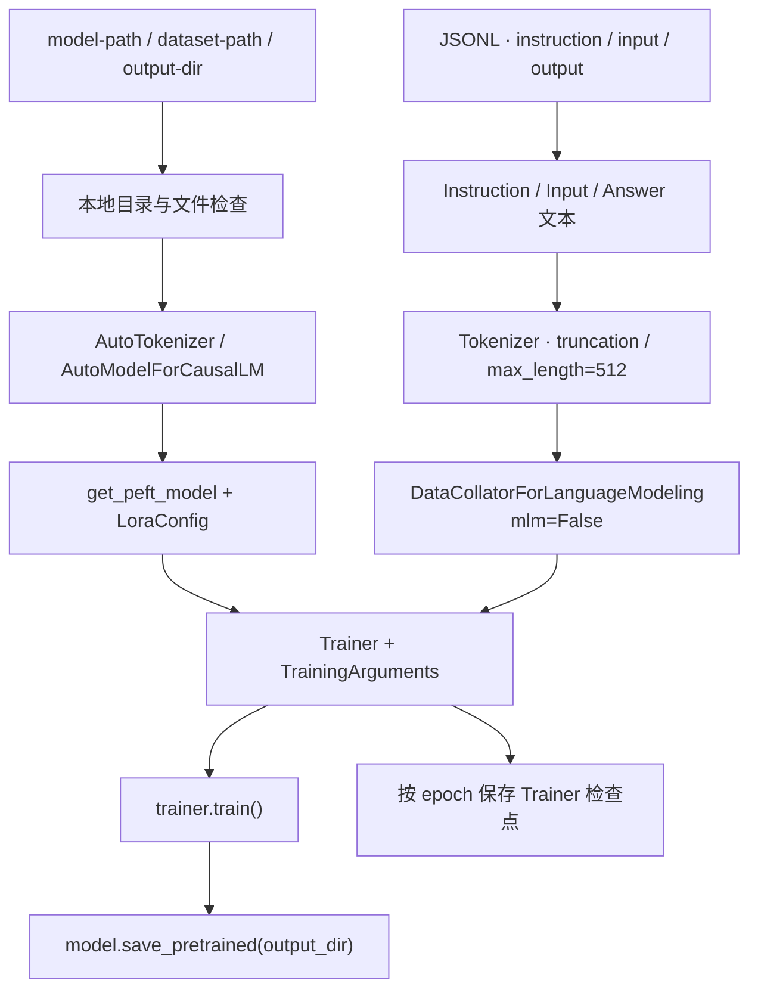
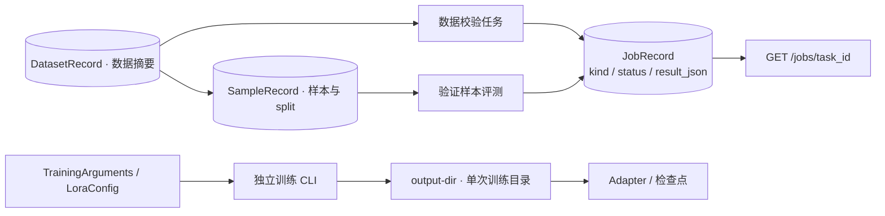
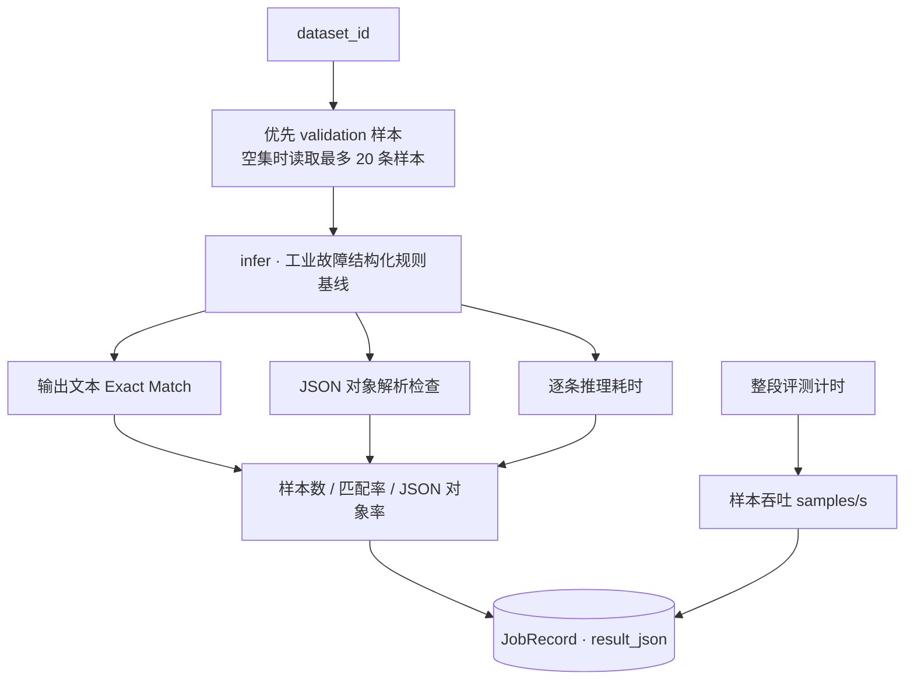

<div align="center">

# LLM Fine-tuning & Evaluation Toolbox

**面向领域指令数据、参数高效微调与结构化评测的工程工具箱**

`FastAPI` · `SFT Dataset` · `Transformers` · `PEFT-LoRA` · `Evaluation`

**Author: Hzhikai** · 基于实际项目经验独立整理 · 开源交流与共同学习

[English](README_EN.md) · [架构设计](docs/architecture.md) · [模块说明](docs/modules.md) · [业务设计](docs/business-design.md) · [训练入口](docs/training.md) · [API](docs/api.md)

</div>

---

> 本仓库中的公开代码、架构设计与技术文档由 **Hzhikai** 基于本人实际项目经验独立整理并授权发布，用于 LLM 应用开发交流、开源共同学习与求职作品展示。欢迎阅读、引用、讨论和改进，并请保留作者与[许可证](LICENSE)信息。

## 项目定位

领域模型工程不只包含训练，还涉及指令数据质量、训练/验证划分、参数配置、产物管理和评测口径。本项目围绕这些环节组织模块化代码，便于阅读数据流、理解训练入口，并通过标准接口管理数据集与评测任务。

工程采用 **“数据服务 + 独立训练 CLI”** 的组织方式：FastAPI 提供数据导入、清洗统计、训练前校验、规则基线推理和评测；本地 LoRA 入口使用 Transformers、PEFT 与 Trainer 加载模型、执行训练并保存 Adapter。两条链路分别保留明确的输入、配置与结果边界。

## 核心能力

| 技术方向 | 具体实现 | 源码入口 |
| --- | --- | --- |
| SFT 数据导入 | CSV、JSONL、Alpaca JSON，UTF-8/BOM 处理与格式检查 | [dataset_pipeline.py](app/dataset_pipeline.py) |
| 数据清洗 | 字段别名映射、首尾空白清理、必填与长度约束、SHA-256 去重 | [清洗管线](app/dataset_pipeline.py) |
| 划分与统计 | 内容指纹划分训练/验证集，重复与拒绝计数，输入字符长度统计 | [clean_and_split](app/dataset_pipeline.py) |
| PEFT-LoRA | 本地 Causal LM 加载、LoRA 注入、Trainer 训练与 Adapter 保存 | [train_lora.py](scripts/train_lora.py) |
| 训练配置 | LoRA 超参数、序列长度、梯度累积、日志间隔与 epoch 检查点策略 | [训练入口](scripts/train_lora.py) |
| 任务管理 | 数据集 UUID、样本关联、训练前校验任务与评测结果持久化 | [service.py](app/service.py) · [db.py](app/db.py) |
| 推理评测 | 工业故障结构化规则基线、Exact Match、JSON 对象率、延迟与样本吞吐 | [评测服务](app/service.py) · [推理入口](app/demo_model.py) |
| 接口工程 | Pydantic 契约、OpenAPI、文件上传、统一业务错误 | [main.py](app/main.py) · [schemas.py](app/schemas.py) |

## 系统架构



[架构设计](docs/architecture.md)说明服务与 CLI 的调用边界；[业务设计导读](docs/business-design.md)按数据、训练和评测串联源码。

## 关键业务设计

### 1. SFT 数据准备：多格式输入统一成样本模型

解析层负责文件格式和文本解码，清洗层负责字段规范及样本质量。输入支持 `instruction/prompt`、`input/input_text`、`output/response` 别名，归一化后存储为统一样本字段。



- **字段归一化**：兼容常见指令数据格式，将业务字段与文件格式解耦。
- **质量可见**：区分保留、重复和拒绝样本，返回数据质量摘要。
- **关联完整**：数据集与样本通过 `dataset_id` 关联，划分结果随样本保存。

源码入口：[解析与清洗](app/dataset_pipeline.py) · [导入服务](app/service.py) · [数据模型](app/db.py)

### 2. 去重与划分：用内容指纹管理数据一致性

清洗后将指令、输入和输出以空字符分隔，转为小写并计算 SHA-256。相同指纹用于去重；指纹前八位映射到区间数值，默认按 0.2 阈值分配验证集，小样本退化时补齐训练与验证分支。



- **内容去重**：比较规范化后的三字段组合，不依赖行号或文件名。
- **稳定分桶**：主要划分由内容指纹决定，便于理解样本归属。
- **口径清晰**：长度统计使用“指令 + 输入”的字符数，训练时再由 Tokenizer 处理序列。

源码入口：[clean_and_split](app/dataset_pipeline.py)

### 3. Transformers + PEFT：独立的 LoRA 训练链路

训练脚本显式接收模型目录、JSONL 数据路径和输出目录。Tokenizer 与 Causal LM 从本地目录加载，随后注入 LoRA，构建指令文本并进行分词，交给 Trainer 执行因果语言模型训练。



- **参数高效适配**：LoRA 配置为 `r=8`、`alpha=16`、`dropout=0.05`，目标为 `all-linear`。
- **训练组织**：单设备 batch size 为 1，梯度累积 4 步，训练 1 个 epoch，每 5 步记录日志。
- **产物分离**：训练输出按指定目录组织，API 数据与模型训练产物分别管理。

源码入口：[LoRA 训练脚本](scripts/train_lora.py) · [参数与调用说明](docs/training.md)

### 4. 任务与实验组织：数据标识、任务结果和训练目录分层管理

数据集导入后生成 UUID，训练前校验任务和评测任务关联该数据集，并保存类型、状态与结果。LoRA CLI 使用显式输出目录组织一次训练的日志和模型产物；数据校验、基线评测与模型训练分别具有清晰的结果语义。



- **数据可定位**：样本与任务共同引用数据集 ID。
- **结果可查询**：以 `task_id` 查询质量检查与评测结果。
- **配置可阅读**：训练超参数集中在脚本的 `LoraConfig` 与 `TrainingArguments`，输入和产物路径由 CLI 提供。

源码入口：[任务服务](app/service.py) · [JobRecord](app/db.py) · [训练配置](scripts/train_lora.py)

### 5. 推理与评测：把指标定义和计算过程放在同一条链路中

评测优先读取验证集；验证集为空时读取最多二十条已有样本。逐条调用规则基线推理，比较输出文本、检查 JSON 对象结构并记录耗时，再生成汇总指标和任务记录。



| 指标 | 计算口径 |
| --- | --- |
| exact_match | 去除输出首尾空白后，与参考输出进行文本比较 |
| structured_json_rate | 输出可解析为 JSON 对象的样本比例 |
| average_latency_ms | 逐样本推理耗时均值 |
| throughput_samples_per_second | 样本数除以整段评测耗时 |

指标随任务返回，包含候选标识。源码明确区分规则基线评测与 LoRA 训练，便于按计算对象解读结果。

源码入口：[evaluate](app/service.py) · [infer](app/demo_model.py) · [响应契约](app/schemas.py)

## 源码导航

```text
llm-finetuning-evaluation/
├── app/
│   ├── main.py                # 数据、任务与推理 API
│   ├── dataset_pipeline.py    # 解析、清洗、去重、划分与统计
│   ├── service.py             # 数据管理、前置校验与评测
│   ├── demo_model.py          # 结构化规则基线
│   ├── db.py                  # 数据集、样本、任务及会话
│   ├── schemas.py             # Pydantic 接口契约
│   ├── config.py              # 环境配置
│   └── errors.py              # 统一业务错误响应
├── scripts/
│   ├── train_lora.py          # Transformers / PEFT 训练入口
│   └── generate_demo_dataset.py
├── examples/                  # 指令数据与推理请求
├── docs/                      # 架构、模块、训练与 API
├── tests/                     # 数据管线与 API 测试源码
├── pyproject.toml             # 核心、开发与训练依赖分组
└── *.ps1                      # Windows 安装与服务管理脚本
```

## 本地使用

环境：**Python 3.12 / 3.13 + PowerShell**。版本范围与训练依赖分组见 [pyproject.toml](pyproject.toml)。

```powershell
git clone https://github.com/Kailovek/llm-finetuning-evaluation.git
cd llm-finetuning-evaluation
Copy-Item .env.example .env
.\setup.ps1
.\start.ps1
```

Swagger：`http://127.0.0.1:8103/docs`。导入 [instruction_samples.jsonl](examples/instruction_samples.jsonl) 后，可通过数据集 ID 查询摘要、提交数据校验和评测任务。完整调用示例见 [API 文档](docs/api.md)。结束使用时运行 `.\stop.ps1`。

训练入口单独调用，并显式指定已有本地模型：

```powershell
.\.venv\Scripts\python.exe -m pip install -e ".[training]"
.\.venv\Scripts\python.exe .\scripts\train_lora.py `
    --model-path .\local-models\base-model `
    --dataset-path .\examples\instruction_samples.jsonl `
    --output-dir .\outputs\lora\run-001
```

数据格式、训练参数与产物说明见 [训练指南](docs/training.md)。本地环境配置使用 `.env`，数据、权重、Adapter、检查点与运行日志由 `.gitignore` 排除。

## API 契约

| 方法与路径 | 用途 |
| --- | --- |
| `GET /api/v1/health` | 服务状态 |
| `POST /api/v1/datasets/import` | 上传并清洗指令数据 |
| `GET /api/v1/datasets/{dataset_id}` | 查询摘要与质量统计 |
| `POST /api/v1/training-jobs` | 创建训练前数据校验任务 |
| `POST /api/v1/evaluation-jobs` | 创建规则基线评测任务 |
| `GET /api/v1/jobs/{task_id}` | 查询任务结果 |
| `POST /api/v1/inference` | 结构化规则基线推理 |

接口模型由 Pydantic 定义，Swagger 与 OpenAPI 分别位于 `/docs`、`/openapi.json`。

## 作者与开源

- **Hzhikai**：公开工程设计、应用实现与技术文档，见 [AUTHORS.md](AUTHORS.md)。
- 自有代码与文档采用 [MIT License](LICENSE)，依赖版权见 [THIRD_PARTY_NOTICES.md](THIRD_PARTY_NOTICES.md)。
- 公开模块与阅读方式见 [PUBLICATION_SCOPE.md](PUBLICATION_SCOPE.md)。

欢迎围绕指令数据质量、LoRA 配置和评测方法交流、引用与改进。基础模型及数据集使用应遵守各自许可，领域输出应结合专业知识复核。
