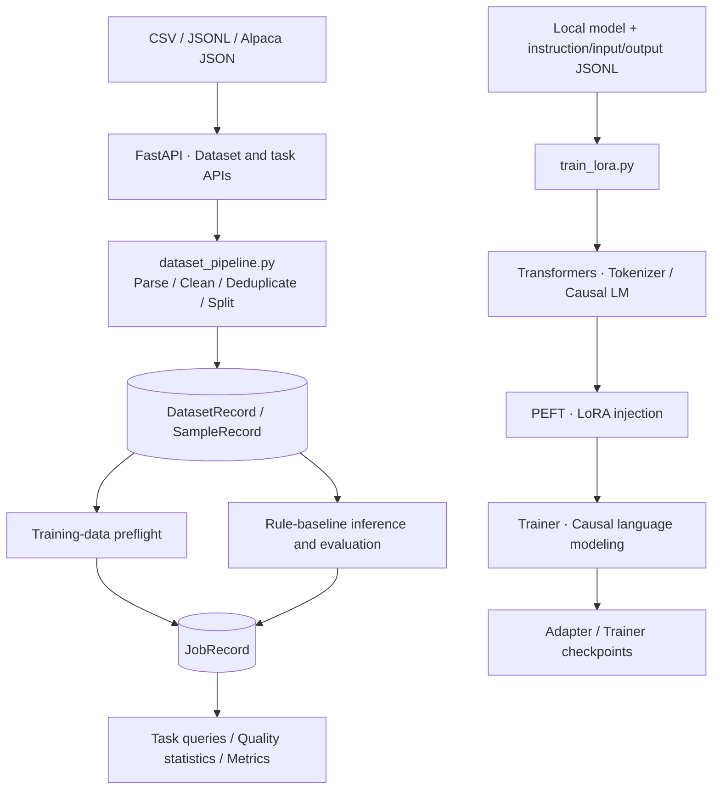
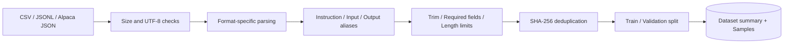
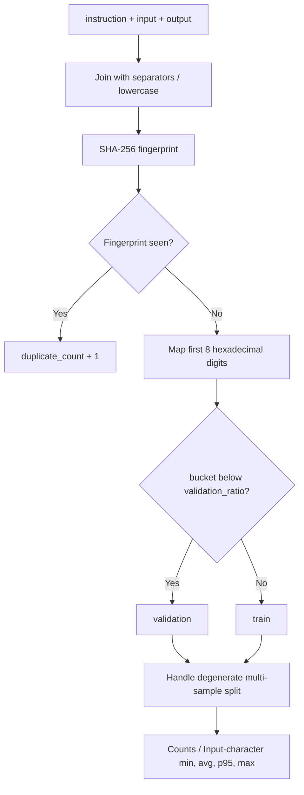
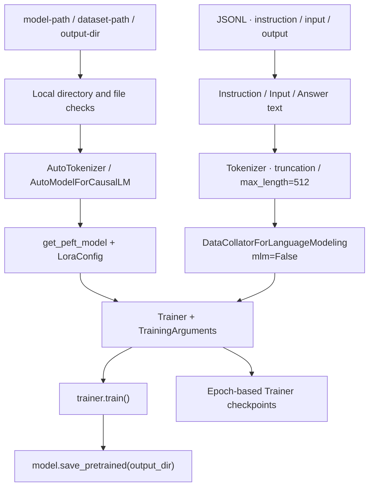
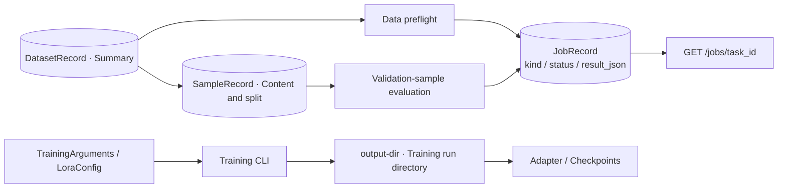
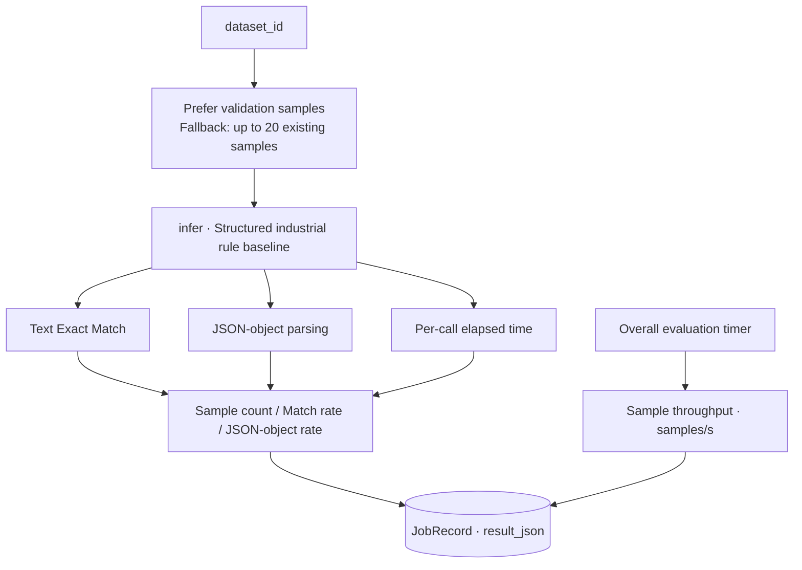

<div align="center">

# LLM Fine-tuning & Evaluation Toolbox

**Engineering tools for domain instruction data, parameter-efficient training and structured evaluation**

`FastAPI` · `SFT Dataset` · `Transformers` · `PEFT-LoRA` · `Evaluation`

**Author: Hzhikai** · Independently organized from practical project experience · Open collaboration and shared learning

[中文](README.md) · [Architecture](docs/architecture.md) · [Modules](docs/modules.md) · [Business design](docs/business-design.md) · [Training](docs/training.md) · [API](docs/api.md)

</div>

---

> The public code, architecture and technical documentation in this repository are independently organized and authorized for publication by **Hzhikai**, based on personal project experience, for LLM application development, open collaboration, shared learning and portfolio presentation. Reading, citation, discussion and improvements are welcome. Please retain the author and [license](LICENSE) notices.

## Overview

Domain-model engineering includes instruction-data quality, train/validation splits, training configuration, artifacts and evaluation definitions. This toolkit organizes those concerns into readable modules with standard dataset and task APIs.

The design separates a **data service and a training CLI**. FastAPI handles data import, cleaning, statistics, training-data preflight, rule-based inference and evaluation. The local LoRA entry point uses Transformers, PEFT and Trainer to load a model, train adapters and save artifacts. Each path has explicit inputs, settings and result semantics.

## Capabilities

| Area | Implementation | Source |
| --- | --- | --- |
| SFT import | CSV, JSONL, Alpaca JSON; UTF-8/BOM handling and format checks | [dataset_pipeline.py](app/dataset_pipeline.py) |
| Cleaning | Field aliases, whitespace trimming, required/length checks and SHA-256 deduplication | [Pipeline](app/dataset_pipeline.py) |
| Splits and statistics | Content-fingerprint partitioning, duplicate/rejected counts and input-character statistics | [clean_and_split](app/dataset_pipeline.py) |
| PEFT-LoRA | Local causal model loading, adapter injection, Trainer and adapter saving | [train_lora.py](scripts/train_lora.py) |
| Training settings | LoRA parameters, sequence length, gradient accumulation, logging and epoch checkpoints | [Training entry](scripts/train_lora.py) |
| Task management | Dataset UUIDs, linked samples, preflight and evaluation records | [service.py](app/service.py) · [db.py](app/db.py) |
| Inference and evaluation | Structured industrial rule baseline, Exact Match, JSON-object rate, latency and sample throughput | [Evaluation](app/service.py) · [Inference](app/demo_model.py) |
| API engineering | Pydantic contracts, OpenAPI, file upload and structured business errors | [main.py](app/main.py) · [schemas.py](app/schemas.py) |

## Architecture



See [architecture](docs/architecture.md) for boundaries and the [business guide](docs/business-design.md) for source-level data flows.

## Key designs

### 1. SFT preparation: normalize multiple input formats

Parsing handles file formats and decoding; cleaning handles field names and sample quality. Aliases include `instruction/prompt`, `input/input_text` and `output/response`, which become common sample fields.



- **Normalized fields:** file formats are separated from the internal sample model.
- **Visible quality:** retained, duplicate and rejected counts accompany the dataset.
- **Linked records:** samples and their split labels are stored under a `dataset_id`.

Source: [Parsing and cleaning](app/dataset_pipeline.py) · [Import service](app/service.py) · [Models](app/db.py)

### 2. Deduplication and splits: content fingerprints

The cleaned instruction, input and output are joined with null separators, lowercased and hashed with SHA-256. Fingerprints detect duplicates; their first eight hexadecimal digits determine a bucket. The default validation threshold is 0.2, with small-sample fallback to populate both splits when more than one sample remains.



- **Content-based deduplication:** identity comes from the normalized three-field combination.
- **Stable buckets:** fingerprints determine the primary partition.
- **Explicit units:** input lengths count instruction-plus-input characters; tokenization happens in training.

Source: [clean_and_split](app/dataset_pipeline.py)

### 3. Transformers + PEFT: a separate LoRA training path

The script accepts a model directory, JSONL dataset and output directory. It loads a local tokenizer and causal model, injects LoRA, formats instruction text, tokenizes it and executes causal language-model training through Trainer.



- **Parameter-efficient adaptation:** `r=8`, `alpha=16`, `dropout=0.05`, targeting `all-linear`.
- **Training organization:** batch size 1, gradient accumulation 4, one epoch and logging every five steps.
- **Artifact boundaries:** explicit output paths keep training files separate from API data.

Source: [LoRA script](scripts/train_lora.py) · [Training guide](docs/training.md)

### 4. Tasks and experiment organization

Datasets receive UUIDs. Data-preflight and evaluation tasks reference those datasets and persist their type, status and result. The LoRA CLI uses an explicit output directory for training artifacts. Data checks, baseline evaluation and model training therefore have distinct result semantics.



- **Dataset identity:** both samples and service tasks reference the dataset ID.
- **Queryable results:** preflight and evaluation outcomes are retrieved by `task_id`.
- **Readable configuration:** hyperparameters live in `LoraConfig` and `TrainingArguments`; paths are supplied through the CLI.

Source: [Task service](app/service.py) · [JobRecord](app/db.py) · [Training settings](scripts/train_lora.py)

### 5. Inference and evaluation: explicit metric definitions

Evaluation prefers validation samples; when that split is empty, it reads up to twenty existing samples. Each sample is passed through the rule baseline, compared with its reference output and checked for JSON-object validity. Per-call and overall elapsed times supply latency and throughput metrics.



| Metric | Definition |
| --- | --- |
| exact_match | Text equality after trimming outer whitespace |
| structured_json_rate | Fraction of outputs parsed as JSON objects |
| average_latency_ms | Mean per-sample inference time |
| throughput_samples_per_second | Sample count divided by overall evaluation time |

Results include the candidate identifier. Rule-baseline metrics and LoRA training are separate code paths, keeping the measurement target explicit.

Source: [evaluate](app/service.py) · [infer](app/demo_model.py) · [Contracts](app/schemas.py)

## Source map

```text
llm-finetuning-evaluation/
├── app/
│   ├── main.py                # Dataset, task and inference APIs
│   ├── dataset_pipeline.py    # Parse, clean, deduplicate, split and summarize
│   ├── service.py             # Dataset management, preflight and evaluation
│   ├── demo_model.py          # Structured rule baseline
│   ├── db.py                  # Dataset, sample, job and session models
│   ├── schemas.py             # API contracts
│   ├── config.py              # Environment settings
│   └── errors.py              # Business error responses
├── scripts/
│   ├── train_lora.py          # Transformers / PEFT training entry
│   └── generate_demo_dataset.py
├── examples/                  # Instruction data and inference requests
├── docs/                      # Architecture, modules, training and API
├── tests/                     # Pipeline and API test sources
├── pyproject.toml             # Core, development and training dependencies
└── *.ps1                      # Windows setup and service scripts
```

## Local usage

Environment: **Python 3.12 / 3.13 + PowerShell**. Dependency ranges and training extras are in [pyproject.toml](pyproject.toml).

```powershell
git clone https://github.com/Kailovek/llm-finetuning-evaluation.git
cd llm-finetuning-evaluation
Copy-Item .env.example .env
.\setup.ps1
.\start.ps1
```

Swagger: `http://127.0.0.1:8103/docs`. Import [instruction_samples.jsonl](examples/instruction_samples.jsonl), then use its dataset ID for summaries, preflight and evaluation. See [API examples](docs/api.md). Stop the service with `.\stop.ps1`.

Invoke the training entry separately with an existing local model:

```powershell
.\.venv\Scripts\python.exe -m pip install -e ".[training]"
.\.venv\Scripts\python.exe .\scripts\train_lora.py `
    --model-path .\local-models\base-model `
    --dataset-path .\examples\instruction_samples.jsonl `
    --output-dir .\outputs\lora\run-001
```

See the [training guide](docs/training.md) for data fields, parameters and artifacts. Keep local settings in `.env`; data, weights, adapters, checkpoints and runtime logs are excluded by `.gitignore`.

## API contract

| Method and path | Purpose |
| --- | --- |
| `GET /api/v1/health` | Service status |
| `POST /api/v1/datasets/import` | Upload and clean instruction data |
| `GET /api/v1/datasets/{dataset_id}` | Dataset summary and quality statistics |
| `POST /api/v1/training-jobs` | Training-data preflight |
| `POST /api/v1/evaluation-jobs` | Rule-baseline evaluation |
| `GET /api/v1/jobs/{task_id}` | Retrieve task result |
| `POST /api/v1/inference` | Structured rule-baseline inference |

Pydantic defines the contracts; Swagger and OpenAPI are exposed at `/docs` and `/openapi.json`.

## Author and license

- **Hzhikai:** public architecture, application implementation and technical documentation. See [AUTHORS.md](AUTHORS.md).
- Original code and documentation are released under the [MIT License](LICENSE). See [THIRD_PARTY_NOTICES.md](THIRD_PARTY_NOTICES.md) for dependencies.
- Published modules and reading guidance are listed in [PUBLICATION_SCOPE.md](PUBLICATION_SCOPE.md).

Discussion, citation and improvements around instruction-data quality, LoRA configuration and evaluation methods are welcome. Base models and datasets remain subject to their own licenses; domain outputs require appropriate professional review.
