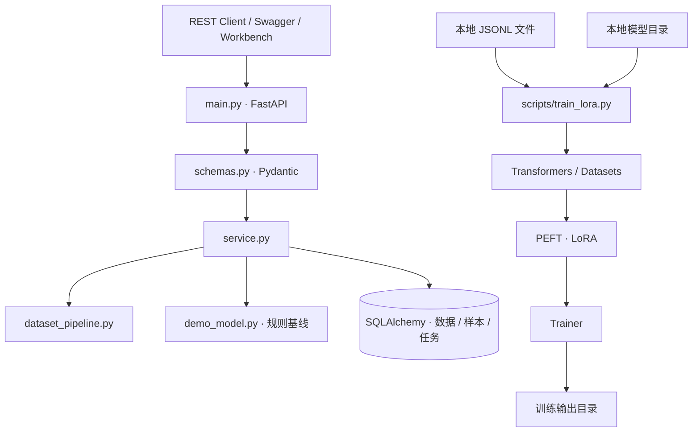
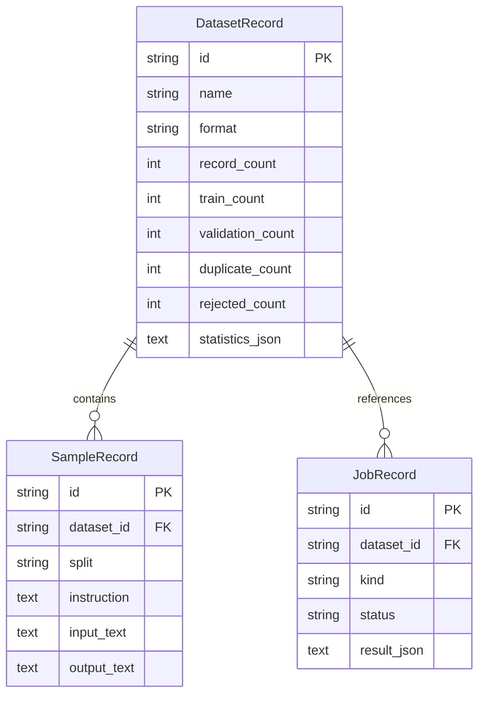

# 系统架构与调用边界

[返回首页](../README.md) · [模块说明](modules.md) · [业务导读](business-design.md) · [训练指南](training.md) · [API](api.md)

## 双入口设计

| 入口 | 输入 | 职责 | 结果 |
| --- | --- | --- | --- |
| 数据服务 | 上传文件、dataset_id、推理文本 | 数据治理、前置校验、规则基线评测、查询 | API 模型与数据库记录 |
| 训练 CLI | 模型目录、JSONL 文件、输出目录 | 本地模型加载、LoRA 注入、Trainer 训练 | Adapter 与 Trainer 检查点 |

CLI 直接读取文件中的 `instruction/input/output` 字段；数据服务将规范化样本保存为 `instruction/input_text/output_text`。两者的输入字段关系见 [训练指南](training.md)。

## 服务分层

- `main.py`：生命周期、数据库初始化、路由、文件上传与依赖注入。
- `service.py`：导入事务、摘要转换、校验与评测任务、结果查询。
- `dataset_pipeline.py`：格式解析、字段映射、清洗、去重、划分及长度统计。
- `demo_model.py`：工业故障结构化规则基线与逐次计时。
- `db.py`：数据模型、引擎、会话与请求依赖。
- `schemas.py`：请求及响应契约。
- `config.py / errors.py`：环境设置与业务错误。

## 数据实体

数据集、样本和任务以 UUID 关联。样本的 `dataset_id`、`split` 及任务的 `dataset_id` 建立索引；数据集摘要与任务保存 UTC 创建时间。

## 执行与结果语义

上传接口解析并清洗数据，先保存数据集摘要，再批量添加样本并提交。校验与评测接口在请求内完成计算并持久化任务，返回 `202` 和已生成的结果；`GET /jobs/{task_id}` 用于回查。

训练前校验接口检查数据可用性与划分信息。模型训练由独立 CLI 调用；训练目录与 SQL 中的校验/评测任务分别管理。评测服务的候选标识为 `demo-rule`，与 `demo_model.py` 的规则基线对应。

## 训练依赖边界

API 核心依赖与可选 `training` 分组分别声明。LoRA 脚本在调用时加载训练依赖，路径参数限定本地模型与数据；Tokenizer 和模型读取使用 `local_files_only=True`。训练超参数由脚本中的 `LoraConfig` 与 `TrainingArguments` 定义。
