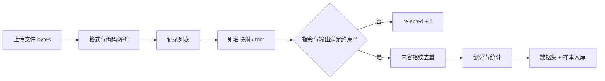
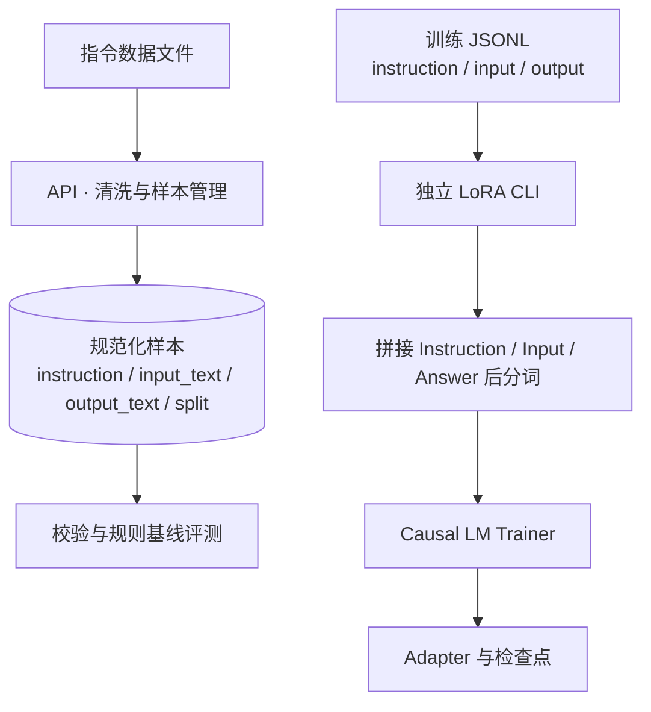
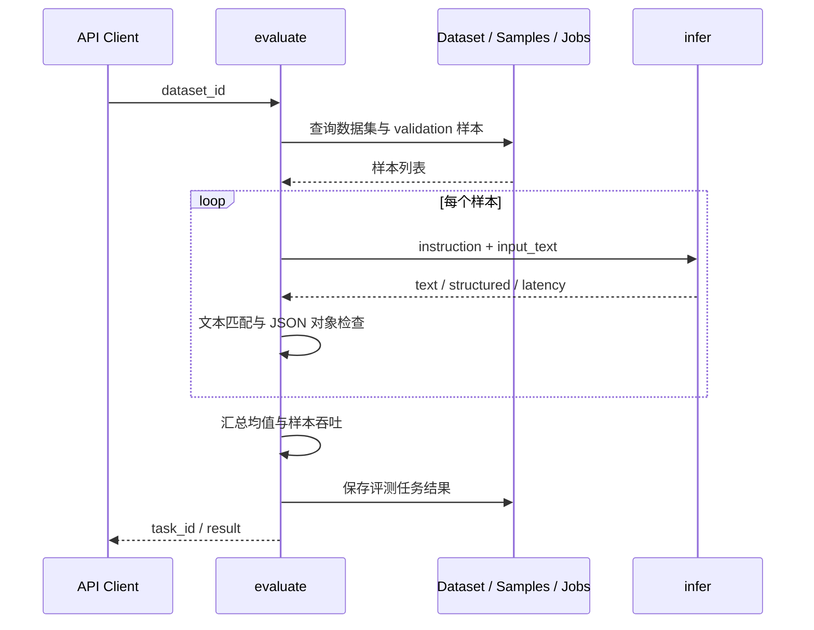

# 数据、训练与评测设计导读

[返回首页](../README.md) · [架构设计](architecture.md) · [训练指南](training.md)

## 1. 文件格式与样本质量分离

解析层依据后缀处理 CSV、JSONL 和 JSON 数组，使用 UTF-8-sig 解码。文件大小上限为 10 MiB；解析失败、格式不支持和超限分别映射为业务错误。

清洗层去除字段首尾空白，接受 instruction/prompt、input/input_text、output/response 别名。指令和输出为必填字段，指令长度上限 4000 字符、输出长度上限 8000 字符。通过的记录再进入内容去重与划分。

## 2. 内容指纹的双重用途

对三个规范化文本字段拼接、转小写并计算 SHA-256：

1. 同一指纹只保留一条，避免重复数据进入本次导入。
2. 指纹前八位转整数，再除以 `0xFFFFFFFF` 得到分桶数值。
3. 小于 validation_ratio 的样本归验证集，其他归训练集。
4. 多样本却只有单侧划分时，调整末条或首条补齐另一侧。

主要划分取决于内容；退化分支涉及样本顺序。数据统计使用指令与输入的字符长度，不以字符长度替代模型 token 数。

## 3. 数据服务与训练文件的边界

API 数据集用于质量管理和服务评测；CLI 读取显式传入的训练文件。输入字段应按各入口契约准备，避免混用规范化存储字段与训练文件字段。

## 4. 配置与产物组织

LoRA 配置集中描述秩、缩放系数、dropout 和目标模块；TrainingArguments 集中描述 epoch、batch、累积步数与日志、保存策略。模型、数据和输出路径通过 CLI 传入。

可按 `outputs/lora/run-001` 等本地目录组织不同训练运行，并保留各次对应的输入路径与参数记录。训练目录和数据库任务记录承担不同职责：前者保存模型产物，后者保存数据校验与基线评测结果。

## 5. 评测指标与测量对象

- Exact Match 对输出字符串去除首尾空白后比较，JSON 字段顺序和序列化空格会影响文本一致性。
- JSON 对象率衡量可解析结构，内容正确性由其他指标或人工复核判断。
- 平均延迟是推理函数内部逐条计时均值；样本吞吐使用整段评测耗时，包含循环与结果检查开销。
- 当前 API 评测对象是规则基线，返回结果带有 candidate 字段。LoRA CLI 的模型训练产物按独立路径保存。

## 6. 讲解建议

先以数据管线说明工程输入质量，再以内容指纹解释去重和划分，随后对照 LoRA/Trainer 参数说明训练链路，最后讲解评测口径、任务结果和模型产物的边界。
