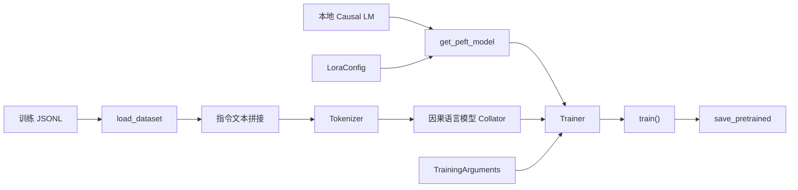

# SFT / LoRA 训练入口

[返回首页](../README.md) · [架构设计](architecture.md) · [脚本源码](../scripts/train_lora.py)

## 入口与输入

训练通过独立 CLI 执行，三个参数均为必填：

| 参数 | 用途 |
| --- | --- |
| --model-path | 已有本地 Causal LM 与 Tokenizer 目录 |
| --dataset-path | JSONL 指令数据文件 |
| --output-dir | Adapter 与训练输出目录 |

JSONL 每行包含 `instruction`、`output` 和可选 `input`。参见 [instruction_samples.jsonl](../examples/instruction_samples.jsonl)。这些字段由脚本拼接成：

```text
Instruction: ...
Input: ...
Answer: ...
```

Tokenizer 截断至 512 token；`DataCollatorForLanguageModeling(mlm=False)` 构造因果语言模型训练批次。该入口使用拼接文本的全序列语言模型目标。

## 调用

在项目根目录使用当前虚拟环境：

```powershell
.\.venv\Scripts\python.exe -m pip install -e ".[training]"
.\.venv\Scripts\python.exe .\scripts\train_lora.py `
    --model-path .\local-models\base-model `
    --dataset-path .\examples\instruction_samples.jsonl `
    --output-dir .\outputs\lora\run-001
```

`model-path` 应指向具备所需配置、Tokenizer 和权重文件的本地目录。使用前确认模型许可，以及 Tokenizer 的 padding 配置与目标模型兼容。代码使用 `local_files_only=True` 读取模型和 Tokenizer。

## 配置与源码对应

| 配置 | 当前值 | 对应对象 |
| --- | --- | --- |
| task_type | CAUSAL_LM | LoraConfig |
| r | 8 | LoraConfig |
| lora_alpha | 16 | LoraConfig |
| lora_dropout | 0.05 | LoraConfig |
| target_modules | all-linear | LoraConfig |
| max_length | 512 | Tokenizer |
| num_train_epochs | 1 | TrainingArguments |
| per_device_train_batch_size | 1 | TrainingArguments |
| gradient_accumulation_steps | 4 | TrainingArguments |
| logging_steps | 5 | TrainingArguments |
| save_strategy | epoch | TrainingArguments |
| report_to | 空列表 | TrainingArguments |

模型加载依据 CUDA 可用性选择 float16 或 float32；设备放置由训练运行时处理。超参数定义位于脚本中，CLI 接收输入与输出路径。

## 数据流



## 产物与任务边界

Trainer 按 epoch 保存检查点，训练结束后调用 PEFT 模型的 `save_pretrained(output_dir)` 保存 Adapter。路径由调用者提供，模型权重和训练目录由 Git 忽略规则保护。

API 的 `training-jobs` 入口用于数据前置校验，API 的评测结果标注规则基线候选；LoRA 训练由本页 CLI 执行。按对应入口解读数据校验结果、评测指标和模型产物。

本页描述源码配置和操作方式，不附训练结果、性能数字或 Loss 图。基础模型与数据集需遵守各自来源的授权条款。
